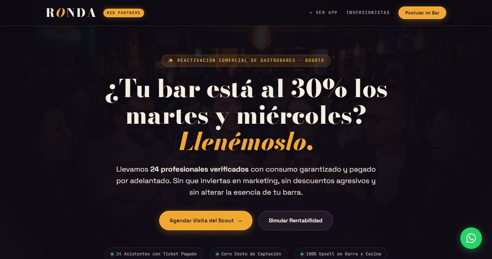

# Auditoría y reparación — Landing de Partners (`/partners`)

**Fecha:** 2 de noviembre de 2026
**Alcance:** `partners.html` (fuente), `dist/partners.html` (artefacto publicado), scripts de build
**Síntoma reportado:** «Algo pasa con el landing de partners» — aparece un bloque de texto crudo sobre el hero y el encabezado se hunde unos 470 px.

---

## 1. Resumen ejecutivo

El landing no tenía un problema de diseño ni de contenido: **el archivo HTML estaba contaminado con un informe en prosa pegado antes de la declaración `<!DOCTYPE html>`**. Eso produjo dos fallos simultáneos:

1. **Una banda de texto visible** en la parte superior de la página (el informe se renderizaba como contenido del `<body>`).
2. **Modo quirks en todo el documento** (`document.compatMode === "BackCompat"`): al no haber doctype válido al inicio, el navegador dejó de aplicar el modo estándar, alterando el modelo de caja y el cálculo de alturas en toda la página.

Además se encontraron **6 defectos funcionales** que rompían la conversión (imágenes del cronograma en 404, botón de reproducción engañoso, datos de la calculadora que nunca llegaban al CRM, contador de visitas duplicado, tipografías de marca que nunca se cargaban y un total estático que no cuadraba con su propio desglose).

Todo quedó corregido en fuente y en `dist/`, verificado en navegador real, y se añadió una **puerta de integridad en el build** para que este tipo de incidente no pueda volver a publicarse.

---

## 2. El problema raíz (con evidencia)

### 2.1 Qué pasó

`partners.html` comenzaba así:

```text
L1:   El archivo `partners.html` es tu **embudo de captación B2B para dueños y
      administradores de gastrobares y speakeasies en Bogotá**...
L2..154:  ... (informe completo: fortalezas, bugs, plan de mejora)
L155: ¿Quieres que te entregue el bloque de código `<script>` y el HTML del
      footer/header corregidos...?<!DOCTYPE html>
L156: <html lang="es-CO">
```

Es decir: **9.731 caracteres de prosa (154 líneas) antes del doctype**. El archivo se guardó así, se compiló así y se publicó así.

### 2.2 Por qué el navegador lo mostraba como banda negra

Según la especificación de parseo de HTML, cuando el documento **no empieza** con un doctype y hay datos de caracteres antes de `<html>`, el navegador:

- entra en **quirks mode** (compatibilidad con navegadores de 1999), y
- **empuja ese texto al `<body>`** como contenido normal.

Resultado visual: el texto aparecía como primer bloque de la página, empujando el `header` sticky hacia abajo. En la captura del reporte, la barra de navegación está en `y ≈ 470 px`.

### 2.3 Por qué se veía en el dominio publicado

`firebase.json` sirve `public: "dist"` con la regla `/partners → /partners.html`. El emulador de Hosting (puerto 5002) entregaba `dist/partners.html`, que **ya contenía el mismo texto pegado**:

```
$ curl -s http://127.0.0.1:5002/partners | head -c 120
El archivo `partners.html` es tu **embudo de captación B2B ...
```

No era un problema de caché ni del servidor: **el artefacto publicado estaba contaminado**.

### 2.4 Mediciones antes / después

| Medición (navegador real, 1366×900) | Antes | Después |
|---|---|---|
| Primer byte del HTML servido | `El archivo \`partners.html\` es tu **embudo**…` | `<!DOCTYPE html>` |
| `document.compatMode` | `BackCompat` (quirks) | `CSS1Compat` (estándar) |
| Nodos de texto sueltos en `<body>` | 1 (9.731 caracteres) | 0 |
| Posición del `header` | `y ≈ 470 px` | `y = 0` |
| Tipografía Bodoni Moda cargada | `false` (caía a Georgia) | `true` |
| Imágenes del cronograma | 3 de 5 en 404 | 5 de 5 cargando |
| Contadores de visitas en el footer | 2 (`Visitas: 142 ...`) | 1 (`Visitas: 5`) |
| Total estático de la calculadora | `$1.124.000` (no cuadra) | `$1.125.600` (cuadra) |
| Clic en el botón ▶ | abría el formulario de datos | abre el reel de video |
| `source` guardado en el lead | siempre `partners_landing` | origen real del clic |

---

## 3. Auditoría completa de la landing

Severidad: **P0** = página rota o sin conversión · **P1** = funcional/comercial · **P2** = accesibilidad y robustez.

### P0 — Página rota

| # | Hallazgo | Evidencia | Estado |
|---|---|---|---|
| 1 | Informe en prosa pegado antes del `<!DOCTYPE html>`: banda de texto + modo quirks | 9.731 caracteres / 154 líneas antes de L155 | **Corregido** |
| 2 | El artefacto publicado (`dist/partners.html`) llevaba la misma contaminación | respuesta del emulador en `/partners` | **Corregido** (rebuild) |
| 3 | Tres imágenes del cronograma no existían: `tl-1-host-setup.jpg`, `tl-2-checkin.jpg`, `tl-3-ronda.jpg` | `public/assets/img/` sólo tiene `acto-*`, `sobremesa.jpg`, `founder-welcome-bg.jpg` → 404 silencioso | **Corregido** |

### P1 — Funcional y comercial

| # | Hallazgo | Impacto | Estado |
|---|---|---|---|
| 4 | El botón ▶ del bloque «El concepto en sala» abría el **formulario de datos**, no un video (`openModal('Video Reel')`) | Bait-and-switch: el dueño del bar espera ver el ambiente y recibe un formulario → rechazo inmediato | **Corregido**: lightbox con `/assets/ronda-pitch-video.mp4` |
| 5 | `openModal(src)` recibía el origen del clic pero **lo descartaba**; `handleFormSubmit` guardaba `source: 'partners_landing'` fijo | Se perdía la atribución (calculadora / CTA final / header) en el CRM | **Corregido** |
| 6 | Los valores de la calculadora (`cocktailSlider`, `foodSlider`) nunca se adjuntaban al lead ni al mensaje de WhatsApp | El Scout llegaba a la visita sin la munición comercial que el propio bar había calculado | **Corregido**: van a `notes` del lead y al texto de WhatsApp |
| 7 | El total estático `$1.124.000` no coincidía con su desglose (`576.000 + 230.400 + 319.200 = 1.125.600`) | Falla de credibilidad en la única cifra dura de la página | **Corregido** |
| 8 | Dos etiquetas `<b class="ronda-visit-count-val">` seguidas; la segunda quedaba fija en `...` | El footer mostraba `Visitas: 142 ...` para siempre | **Corregido** |
| 9 | `preconnect` a Google Fonts **sin el `<link>` de la hoja de estilos** (y sin `@import` en `ronda-tokens.css`) | Bodoni Moda, Space Grotesk y JetBrains Mono nunca se cargaban: toda la identidad tipográfica caía a Georgia / system-ui | **Corregido** |
| 10 | El FAQ decía «entre 7:00 PM y **9:30 PM**» pero el cronograma cierra a las **9:00 PM** | Contradicción interna sobre el horario que el bar debe reservar | **Corregido** (FAQ alineado al cronograma) |
| 11 | Persistencia del lead: `fetch(...).catch(() => null)` se tragaba cualquier rechazo de `firestore.rules` | Un lead rechazado (p. ej. `phone` &lt; 7 caracteres) mostraba «¡Postulación Recibida!» y **se perdía en silencio** | **Corregido**: validación en cliente + log del rechazo |
| 12 | Faltaba `<meta name="description">` (había OG/Twitter, pero no description ni `robots`) | Resultado pobre en Google y en previews | **Corregido** |

### P2 — Accesibilidad y robustez

| # | Hallazgo | Estado |
|---|---|---|
| 13 | El botón ▶ era un `<div>` con `onclick`: inalcanzable por teclado | **Corregido** (`<button type="button">` + `aria-label`) |
| 14 | El botón hamburguesa no exponía `aria-expanded` ni `aria-controls` | **Corregido** |
| 15 | Los 5 puntos del cronograma eran botones sin nombre accesible | **Corregido** (`aria-label` por paso) |
| 16 | Ningún modal se cerraba con `Escape` | **Corregido** |
| 17 | Inputs del formulario sin `maxlength` / `autocomplete` / `inputmode` | **Corregido** |

---

## 4. Correcciones aplicadas

### 4.1 Fuente — `partners.html`

1. **Purga del informe pegado** (9.731 caracteres) y `<!DOCTYPE html>` al byte 0 → restaura modo estándar.
2. `<meta name="description">` + `<meta name="robots">`.
3. `<link>` real a Google Fonts con las tres familias de marca.
4. Cronograma: las 3 imágenes inexistentes ahora apuntan a fotos reales del proyecto
   (`acto-1-llegada.jpg`, `acto-4-brindis.jpg`, `acto-2-conversacion.jpg`).
5. Botón ▶ → `<button>` que abre un **lightbox de video** (`reel-overlay` + `/assets/ronda-pitch-video.mp4`), con cierre por clic fuera, por ✕ y por `Escape`.
6. `openModal(src)` ahora **conserva el origen** (`leadSource`) y lo envía como `source` del lead.
7. `calcSnapshot()` adjunta cóctel, ticket de comida y proyección al `notes` del lead y al mensaje de WhatsApp cuando el modal se abre desde la calculadora.
8. Total estático de la calculadora corregido a `$1.125.600`.
9. Eliminado el segundo contador `...` del footer.
10. Validación de `name` (1–100) y `phone` (≥ 7 dígitos) antes de enviar, para no chocar con `firestore.rules`; los rechazos de red ya no se silencian.
11. FAQ de horarios alineado al cronograma (Host 6:30 PM · check-in 7:00 PM · ronda 7:15–9:00 PM · zona libre 9:15 PM).

### 4.2 Artefacto — `dist/`

Rebuild completo con `VITE_IS_DEMO=false` (mismo camino que `npm run build:prod`). Sólo cambió `dist/partners.html` (83.346 → 79.544 bytes); el resto de páginas y bundles se regeneró idéntico.

### 4.3 Prevención — puerta de integridad en el build

Nuevo `scripts/check-html-integrity.cjs`, enganchado en **`prebuild`** (por tanto en `npm run build`) y en **`scripts/build-prod.cjs`** (por tanto en `npm run build:prod`). Verifica:

- **A.** El primer token no-blanco de cada HTML es `<!DOCTYPE html>`.
- **B.** No hay texto suelto antes del doctype.
- **C.** Toda referencia `/assets/...` o `/models/...` existe en `public/` (la clase de bug de las `tl-*.jpg`).
- **D.** Exactamente un `<html>` y un `</html>` reales (ignora plantillas JS de ventanas de impresión).

**Prueba negativa ejecutada:** con una página sonda que reproduce el incidente (prosa pegada + `tl-1-host-setup.jpg` inexistente) el gate detecta los dos fallos y **aborta el build con exit 1**. Sin la sonda: `Todo limpio: 11 páginas, 26 assets locales`.

---

## 5. Verificación

Navegador real (Edge headless vía CDP) contra `http://127.0.0.1:5002/partners`, 1366×900:

```text
compatMode              : CSS1Compat            (modo estándar)
doctype                 : html
bodyFirstTag            : DIV.hero-bg-container (sin texto suelto)
strayTextNodes          : []                    (0)
horizontalOverflow      : 0 px
bodoniLoaded            : true
spaceGroteskLoaded      : true
calcTotal               : $ 1.125.600           (= 576.000 + 230.400 + 319.200)
breakdown               : [$ 576.000, $ 230.400, $ 319.200]
visitCounter            : "5"   ·  pills: 1     (sin "...")
tlBgs                   : 5/5 con asset real
playClick → reelOpen    : true
playClick → leadModal   : false                 (ya no engaña)
videoSrc                : /assets/ronda-pitch-video.mp4
Escape / cierre         : reel cerrado, scroll liberado
calculadora 24.000 → 30.000 : $ 1.125.600 → $ 1.327.200
submit → successBox     : block · form: none
WhatsApp                : incluye bar, zona, teléfono y proyección de la noche
```

Capturas guardadas:

- `docs/img/partners-20261102-hero.png` — primer viewport (encabezado arriba, hero con Bodoni Moda, sin banda de texto).
- `docs/img/partners-20261102-despues.png` — página completa (8.407 px).



---

## 6. Decisiones pendientes (no las toqué: son de negocio)

Estas no son fallos técnicos; son inconsistencias de contenido entre páginas que **sí** pueden costar una alianza o crear un riesgo comercial/legal. Requieren tu decisión:

### 6.1 Horario oficial entre las tres páginas

- `partners.html`: Host 6:30 PM · check-in 7:00 PM · ronda 7:15–9:00 PM.
- `index.html` e `invest.html`: eventos **20:00–21:45**, check-in 19:40–19:55.

Un bar que agende su personal para las 9:00 PM y reciba usuarios a las 8:00 PM tiene un conflicto operativo el día uno. **Recomendación:** fijar `20:00–21:45` como horario único (lo dicen 2 de 3 páginas y es el que consume la app) y reescribir el cronograma de `partners.html` en consecuencia. Si prefieres 7:00 PM por la salida de oficina, hay que cambiar `index.html` e `invest.html`.

### 6.2 Enlace `/invest` visible en la vista B2B

El header y el footer de `partners.html` enlazan a «Inversionistas» / «Pista Privada para Inversionistas FFF». Ese enlace expone al dueño del bar que estás levantando capital y las condiciones de penalidad. **Recomendación:** retirarlo de la vista de partners (la ruta sigue existiendo, simplemente no se enlaza desde aquí).

### 6.3 Contradicción de condiciones comerciales

- `partners.html`: «cancelación con 72 h sin penalidad», «flexibilidad total», «sin contratos de permanencia».
- `invest.html`: penalidad de **$550.000** si se cancela con menos de 24 h, y un SaaS futuro de **$550.000/mes + $7.500/asistente**.

Si un gerente ve ambas páginas, la promesa de cero riesgo queda desmentida. **Recomendación:** una sola versión de la verdad por audiencia, y coherencia entre lo que se firma y lo que se publica.

### 6.4 Falta la sección de requisitos físicos

Hoy «Ver requisitos de espacio →» abre el formulario, y la lista de requisitos sólo aparece dispersa. Una tarjeta con los 4 criterios que evalúa el Scout (capacidad de 12 mesas, acústica &lt; 75 dB, luz cálida, despacho de 24 cócteles en 20 min) convierte la selección en exclusividad percibida. **Recomendación:** añadirla como sección propia (`#requisitos`).

### 6.5 Contador de visitas

Ya está sano (un solo indicador, sin `...`), pero un contador público en una página B2B resta exclusividad y en esta etapa los números son bajos. **Recomendación:** retirarlo o moverlo fuera de la vista del dueño del bar.

---

## 7. Archivos tocados y cómo revertir

| Archivo | Cambio |
|---|---|
| `partners.html` | Fuente corregida (purga + 16 correcciones) |
| `dist/partners.html` | Rebuild del artefacto publicado |
| `scripts/check-html-integrity.cjs` | **Nuevo** — gate de integridad |
| `scripts/build-prod.cjs` | Ejecuta el gate antes del build |
| `package.json` | `prebuild` incluye el gate · nuevo `npm run check:html` |

**Respaldos**

- `backups/partners.html.20261102-leak.bak` — el archivo exacto con el informe pegado (84.547 bytes).
- `backups/dist-20261102-220357/` — el `dist/` completo previo al rebuild (77 archivos).

**Reversión puntual:** restaurar el `.bak` sobre `partners.html` y volver a compilar. **No** se recomienda: reintroduce el modo quirks y la banda de texto.

**Verificación manual rápida**

```bash
npm run check:html        # integridad de las 11 páginas
npm run build:prod        # gate + build de producción
curl -s http://127.0.0.1:5002/partners | head -c 15   # debe imprimir <!DOCTYPE html>
```

---

## 8. Nota de proceso

El informe que apareció dentro de `partners.html` era, en sí mismo, una auditoría correcta de esa página (señalaba los enlaces a `/invest`, el botón de play engañoso, el contador duplicado, la falta de fuentes y la desincronización de horarios). El problema fue **dónde** se guardó: pegado dentro del HTML en lugar de en un documento aparte.

De ahí la lección que ahora está codificada en el build: **ninguna página se publica si no empieza con su doctype y si referencia assets que no existen**. Y los informes de análisis viven en `docs/`, no dentro del marcado.
