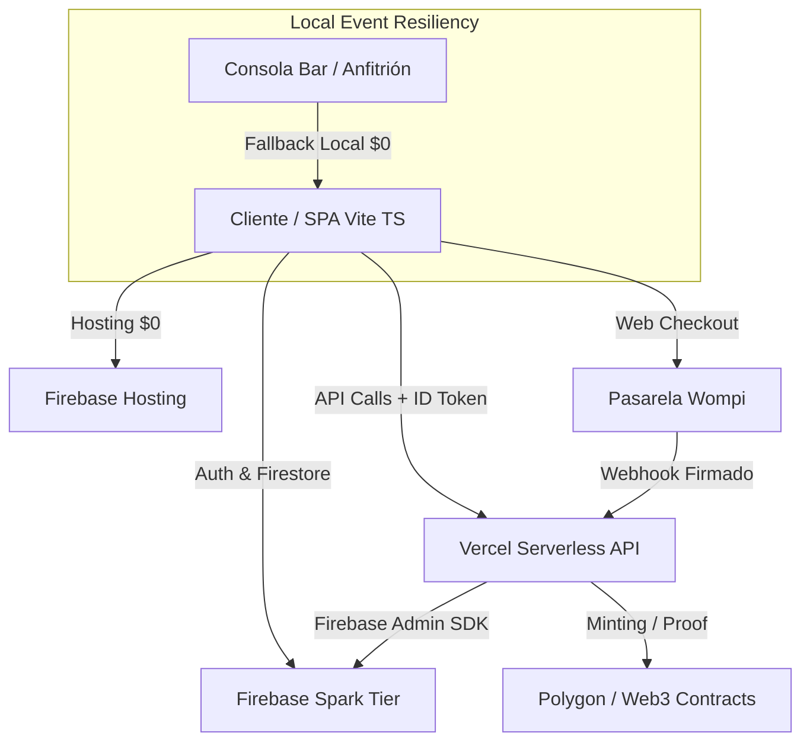
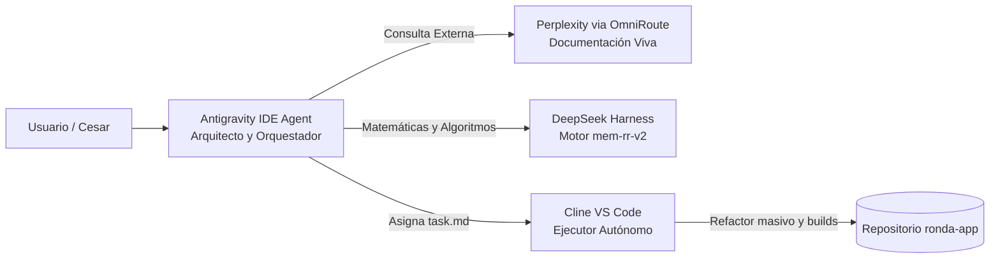

# RONDA — Documento Maestro de Referencia y Arquitectura

> **DOCUMENTO MAESTRO DE REFERENCIA (SSOT — Single Source of Truth)**  
> **Versión:** 2.0 (Arquitectura Serverless $0 + Stack Multi-Agente + Wompi Web Checkout)  
> **Fecha de actualización:** Septiembre 2026  
> **Ubicación oficial:** `docs/MASTER_REFERENCE.md`

---

## 1. Visión y Fundamentos del Proyecto

**RONDA** es una plataforma de citas rápidas (speed-dating) y encuentros presenciales en bares y locales selectos, diseñada para eliminar la fricción de las citas tradicionales mediante tres pilares:

1. **Rotaciones Inteligentes (`mem-rr-v2`):** Algoritmo propio con memoria de encuentros previos, optimización de afinidad y prevención de colisiones (mesas de 2 o 4 personas).
2. **Arquitectura Serverless de Costo $0:** Modelo operativo diseñado para ejecutarse sin costos fijos de servidor (Firebase Spark + Vercel Hobby + Polygon/Web3 local).
3. **Privacidad y Cierre Seguro:** Votación post-evento con privacidad P0 (los participantes nunca saben quién votó qué a menos que haya match mutuo), chats efímeros de 72 horas y verificación de identidad/asistencia vía NFT conmemorativo.

---

## 2. Arquitectura Global del Sistema



### Componentes de la Infraestructura

| Capa | Tecnología | Propósito | Nivel de Costo |
|---|---|---|---|
| **Frontend** | Vanilla TypeScript + Vite (SPA) | Interfaz de usuario para clientes, lobby, perfil y consola de anfitrión (`bar.ts`). | $0 (Firebase Hosting) |
| **Base de Datos & Auth** | Google Cloud Firestore + Firebase Auth | Almacenamiento NoSQL en tiempo real, gestión de sesiones y tokens JWT. | $0 (Spark Plan) |
| **Backend Serverless** | Vercel Serverless Functions (`functions-vercel/api/`) | Endpoints para webhooks seguros de pago, cálculo seguro de matches y minting de NFTs. | $0 (Vercel Hobby) |
| **Pagos** | Wompi Web Checkout + Fallback Nequi QR | Cobro de tickets y pases de evento con confirmación criptográfica vía Webhook o verificación manual por anfitrión. | Variable por transacción |
| **Web3 / Propiedad** | Contratos Solidity (ERC-721) en Polygon | Registro de asistencia y prueba de existencia (Keccak256) sin gas obligatorio en modo reserva. | $0 (Reserva / local) |

---

## 3. Modelo de Seguridad y Reglas de Firestore (`firestore.rules`)

Las reglas de Firestore implementan **Fail-Closed Security** y protegen la integridad de los datos sin requerir Cloud Functions constantes:

### 3.1 Jerarquía de Roles
* `superadmin`: Acceso irrestricto de administración.
* `admin`: Anfitrión del local y gestión de eventos.
* `sales`: CRM y gestión de leads comerciales (`/leads`).
* `network`: Gestión de alianzas y locales (`/venues`).
* `client`: Usuario estándar participante en eventos.

### 3.2 Campos Críticos Protegidos
El cliente tiene **estrictamente prohibido** auto-otorgarse los siguientes campos en su documento de usuario (`/users/{userId}`):
* `hasTicket`: Solo el servidor (Admin SDK) o el staff pueden otorgar acceso al evento tras validar pago.
* `role`: Previene escalada de privilegios a nivel de base de datos.
* `isVerified`, `linkedinVerified`, `nfts`, `wallet_address`, `matches`, `safeword`.

### 3.3 Privacidad P0 de Likes y Matches
* **Colección `/events/{eventId}/likes/{likeId}`:** Cada documento tiene el identificador `${fromUid}_${toUid}`.
* Las reglas impiden que cualquier usuario lea los likes de otros. Únicamente el emisor puede leer su voto y el staff/servidor puede leer la colección para computar matches mutuos.

### 3.4 Chats Efímeros (72 horas)
* **Colección `/chats/{chatId}`:** Expiración lógica por regla temporal sin crons pagos:
  ```javascript
  allow read, write: if request.auth != null && (
    isStaff() || (
      request.auth.uid in resource.data.participants &&
      request.time < resource.data.expiresAt
    )
  );
  ```

---

## 4. Motor de Rotación de Mesas (`src/mem-rr-v2/`)

El algoritmo **Memory-Aware Round Robin (mem-rr-v2)** garantiza que ningún participante repita mesa con alguien que ya conoció en rondas previas o noches pasadas, maximizando la afinidad:

### 4.1 Función Objetivo
La compatibilidad entre dos participantes $i$ y $j$ se calcula como:
$$\text{Score}(i, j) = \alpha \cdot A(i, j) + \beta \cdot F(i, j) - \gamma \cdot R(i, j) - \delta \cdot D(i, j)$$

* $A(i, j)$: Afinidad declarada (gustos, intereses, edad).
* $F(i, j)$: Factor de flujo o compatibilidad de orientación.
* $R(i, j)$: Penalización exponencial si ya se encontraron en rondas o eventos anteriores.
* $D(i, j)$: Distancia o colisión física de mesa.

### 4.2 Métodos de Resolución
1. **Flujo Bipartito Exacto (`flow.ts`):** Para eventos heteronormativos 1 a 1 balanceados.
2. **Programación Dinámica Exacta (`exact.ts`):** Para $N \le 18$, garantizando el óptimo global matemático.
3. **Búsqueda Local y Grafo General (`general.ts`):** Para mesas de 4 personas ($M4$), salas impares y grafos de afinidad no bipartitos.

> **Comando de verificación:**  
> `node src/mem-rr-v2/bench.ts` valida automáticamente todos los casos límite y benchmarks de tiempo.

---

## 5. Endpoints de la API Serverless (Vercel)

Ubicación: `functions-vercel/api/`

| Endpoint | Método | Autenticación Requerida | Función |
|---|---|---|---|
| `/api/wompi-webhook` | `POST` | Firma HMAC Sha256 (`WOMPI_EVENTS_SECRET`) | Recibe notificaciones de transacciones de Wompi, valida la firma criptográfica y activa el `hasTicket = true` en Firestore. |
| `/api/mint-nft` | `POST` | `Authorization: Bearer <idToken>` | Acuña el NFT de asistencia en Polygon usando la wallet administradora o genera el hash de prueba. |
| `/api/process-matches` | `POST` | `Authorization: Bearer <idToken>` (Admin) | Lee los votos de `/events/{id}/likes`, calcula cruces mutuos y escribe los matches de forma atómica. |

---

## 6. Flujo de Pagos (Wompi Web Checkout + Fallback)

1. **Wompi Web Checkout (Principal):**
   * El cliente pulsa "Reservar Pase".
   * Si `VITE_WOMPI_PUBLIC_KEY` está presente, se inyecta dinámicamente el widget `https://checkout.wompi.co/widget.js`.
   * El usuario paga con Tarjeta, PSE, Nequi o Bancolombia dentro del modal de Wompi.
   * Wompi notifica a `https://ronda-api.vercel.app/api/wompi-webhook`.
   * El webhook marca `paymentPending = false` y `hasTicket = true`.

2. **Nequi QR Fallback (Anti-Falla):**
   * Si la llave de Wompi no está configurada o hay problemas de red, se despliega automáticamente el modal con el código QR de Nequi.
   * El usuario realiza la transferencia manual y pulsa "Ya pagué".
   * El estado queda en `paymentPending = true` y el anfitrión confirma físicamente en el check-in del bar.

---

## 7. Ecosistema de Agentes de IA & Prompt Caching

El proyecto está diseñado bajo un modelo **Agent-First** con estricto control de consumo de tokens:

### 7.1 Protocolo de Prompt Caching (Obligatorio)
* Los archivos `AGENTS.md` y `docs/index.md` representan el **Bloque Estático Principal**.
* Cualquier sesión con LLMs (Google Gemini, Anthropic Claude) debe leer ambos archivos en el primer turno y en el mismo orden para activar el almacenamiento en caché de prefijos.

### 7.2 Matriz de Responsabilidades del Stack de IA



* **Antigravity:** Planea, genera `implementation_plan.md`, `task.md` y aprueba el cierre (`walkthrough.md`).
* **Cline:** Ejecuta las tareas locales en VS Code en bucle cerrado (archivos, tests, comandos de terminal).
* **Perplexity:** Resuelve dudas sobre librerías o APIs externas de terceros antes de tocar código.
* **DeepSeek Harness:** Razonamiento profundo y optimización algorítmica para el motor de matching.
* **OmniRoute:** Servidor MCP central en `http://localhost:20128/api/mcp/stream` que une las herramientas.

---

## 8. Guía Operativa y Variables de Entorno

### Archivo `.env` (Frontend Vite)
```env
VITE_VERCEL_API_URL=https://ronda-api.vercel.app
VITE_WOMPI_PUBLIC_KEY=pub_prod_o_test_aqui
VITE_NEQUI_QR_URL=/nequi-qr.png
```

### Variables en Vercel Project (`ronda-api`)
* `FIREBASE_SERVICE_ACCOUNT`: Contenido JSON minificado de la clave de servicio de Firebase.
* `WOMPI_EVENTS_SECRET`: Secreto provisto por Wompi para validar firmas de webhooks.
* `RONDA_PRIVATE_KEY`: Llave privada de la wallet administradora para Polygon.

### Comandos de Terminal Frecuentes
```bash
# Iniciar servidor de desarrollo local
npm run dev

# Validar motor de rotación y benchmarks
node src/mem-rr-v2/bench.ts

# Compilar TypeScript y verificar sintaxis
npx tsc --noEmit

# Compilar para producción
npm run build
```
