# Playbook Operativo del Scout: Estrategia de 90 Días para Alcanzar el Hito C (Retención y 8+ Eventos)

> **Dirigido a:** Scouts y Líderes de Expansión B2B de RONDA  
> **Objetivo:** Garantizar la permanencia del bar afiliado durante sus primeros 90 días, asegurar un mínimo de 8 eventos válidos y maximizar los ingresos del Scout (Hito A: $100k + Hito B: $250k + Hito C: $100k + hasta 12 residuales semanales de $30k = **$810.000 COP a $1.020.000 COP por bar**).

---

## 1. La Matemática del Éxito para el Scout

El negocio del Scout no es simplemente "firmar bares y desaparecer". La mayor parte de la compensación depende de la **vida y recurrencia** del establecimiento:

```
[Hito A: $100.000]   -> Firma autorizada + Verificación independiente
[Hito B: $250.000]   -> Noche 1: Activación exitosa con >= 16 asistentes pagados
[Residuales: $360k]  -> 12 semanas x $30.000 COP (primer evento no paga residual)
[Hito C: $100.000]   -> Día 90: Bar activo + mínimo 8 eventos completados
-------------------------------------------------------------------------
TOTAL POTENCIAL TIER 1: $810.000 COP brutos por bar
TOTAL POTENCIAL TIER 3: $1.020.000 COP brutos por bar (con aceleradores)
```

Si el bar se cae tras el primer evento, el Scout pierde **$460.000 COP** que estaban sobre la mesa. Este playbook proporciona el paso a paso para evitarlo.

---

## 2. Cronograma de 90 Días: Las 3 Fases Tácticas

```mermaid
gantt
    title Cronograma de 90 Días del Scout para Hito C
    dateFormat  X
    axisFormat Día %s
    section Fase 1: Activación
    Onboarding y verificación     :active, 0, 7
    Garantía de mesas y staff      : 7, 14
    Evento 1 (Aforo 16+ Hito B)   :crit, 14, 15
    section Fase 2: Recurrencia
    Seguimiento semanal y residuales : 15, 60
    Monitoreo de upsell del bar    : 20, 50
    Resolución de fricciones       : 30, 60
    section Fase 3: Hito C
    Auditoría pre-corte (6+ eventos): 60, 75
    Consolidación 8 eventos        :crit, 75, 90
    Liquidación Hito C ($100k)     :milestone, 90, 91
```



---

### FASE 1: Activación y Blindaje Operativo (Días 1 a 15)

#### Meta: Cobrar Hito A ($100k) y Hito B ($250k)
1. **Pacto de Barra Cerrado:**
   * Asegurar que el contrato estipule claramente el paquete de barra máximo de **$22.500 COP** (impuestos incluidos) por participante.
   * Evitar malentendidos: no es "precio por trago", es el paquete de 2 consumiciones estándar pactado para los asistentes de RONDA.
2. **Selección de la Zona en Sala:**
   * Acordar con el administrador la ubicación de las mesas: semiprivada, iluminación cálida, lejos de bafles de alto volumen y sin obstruir el paso de meseros.
3. **Capacitación al Bartender y Administrador:**
   * Entregar la "Guía de Barra RONDA": explicar cómo redimir los pases digitales de los asistentes y la importancia de servir con rapidez en los intermedios de rotación.
4. **Presencia en el Evento #1 (Activación):**
   * El Scout debe estar presente 30 minutos antes del inicio del primer evento.
   * Verificar que las mesas estén numeradas y listas.
   * Saludar al Hoster asignado y coordinar con el capitán de meseros.
   * **Objetivo de caja:** Asegurar que el check-in alcance o supere los **16 asistentes** para causar el Hito B.

---

### FASE 2: Rutina Semanal y Cosecha de Residuales (Días 16 a 60)

#### Meta: Cobrar $30.000 COP semanales de residual y acumular eventos para Hito C
1. **Ritmo de Calendario (Días Valle):**
   * El bar debe tener fecha fija semanal: Martes, Miércoles o Jueves.
   * La regularidad crea hábito en los asistentes y en el personal del bar.
2. **El "Check-in de los Lunes" (Vía WhatsApp con el Administrador):**
   * Confirmar reserva del espacio para la noche programada.
   * Preguntar: *"¿Todo el equipo de barra sabe que tenemos fecha este jueves?"*
3. **Monitoreo del Upsell del Bar (El argumento que fideliza al dueño):**
   * RONDA lleva 16 a 24 personas en una noche muerta. Esas personas cenan, piden botellas o se quedan después de los 90 minutos.
   * El Scout le recuerda al dueño al día siguiente: *"Ayer se quedaron 8 personas consumiendo cócteles de la carta regular después de la campana. Eso es venta 100% de ustedes."*
4. **Manejo de Rotación de Personal del Bar:**
   * Si cambian al administrador o bartender principal (muy común en hostelería), el Scout acude en persona antes de la siguiente fecha para alinear al nuevo equipo. No dejar que un nuevo empleado desatienda el evento.

---

### FASE 3: Maduración del Hito C y Renovación (Días 61 a 90)

#### Meta: Alcanzar los 8 eventos válidos y cobrar Hito C ($100.000 COP)
1. **Auditoría del Día 60 (Punto de Control):**
   * El Scout revisa en su portal CRM cuántos eventos válidos lleva el local:
     * Si lleva **5 o más eventos:** Marcha en ritmo perfecto para superar los 8.
     * Si lleva **menos de 4 eventos:** ALERTA AMARILLA. El Scout debe reunirse con el bar para reajustar el día de la semana o coordinar con marketing para impulsar la convocatoria en esa zona.
2. **Auditoría del Día 75 (Recta Final):**
   * Debe contar con al menos **6 o 7 eventos**. Faltan 2 fechas para asegurar el umbral reglamentario.
3. **Llegada al Día 90:**
   * Verificación en el sistema:
     * [x] Establecimiento con afiliación activa (`status: 'active'`).
     * [x] Cero reportes de fraude o disputas abiertas.
     * [x] Mínimo 8 eventos concluidos con aforo válido.
   * El motor genera automáticamente la entrada en el `commission_ledger` por **$100.000 COP** en estado `payable`.

---

## 3. Matriz de Riesgos y Acciones Correctivas del Scout

| Señal de Alerta en el Bar | Causa Raíz | Acción Inmediata del Scout |
| :--- | :--- | :--- |
| El bar cancela una fecha con poca anticipación | El bar reservó una fiesta corporativa privada en día valle | Exigir reprogramación inmediata para la semana siguiente. Notificar a RONDA para no penalizar la ventana de 90 días. |
| Quejas de asistentes por demora en tragos | Personal de barra insuficiente o no enterado | Hablar con el gerente general; sugerir tener los cócteles base premoldeados o preensamblados antes de la llegada. |
| El bar sugiere cambiar la tarifa de barra | Desean cobrar por trago individual y no paquete | Recordar que RONDA llena mesas en noches donde el local estaría vacío; la tarifa de $22.500 COP fue el acuerdo institucional. |
| El bar cambia de administración | Venta del local o cambio de socio | Visita presencial antes de 48 horas; presentar el caso de éxito de las semanas anteriores y validar que el nuevo dueño mantenga el acuerdo. |

---

## 4. Requisitos de Cumplimiento para el Cobro de Comisiones

Para que el Super Administrador pueda aprobar el desembolso manual del Hito C y residuales, el Scout debe mantener al día:
1. **RUT Actualizado:** Con actividad económica coherente (ej. intermediación comercial, servicios de mercadeo o gestión de negocios).
2. **Planilla PILA Verificada:** Certificado de pago de seguridad social como independiente del mes en curso.
3. **Cuenta Bancaria/Nequi:** A nombre exclusivo del titular del contrato (cero transferencias a cuentas de terceros).
